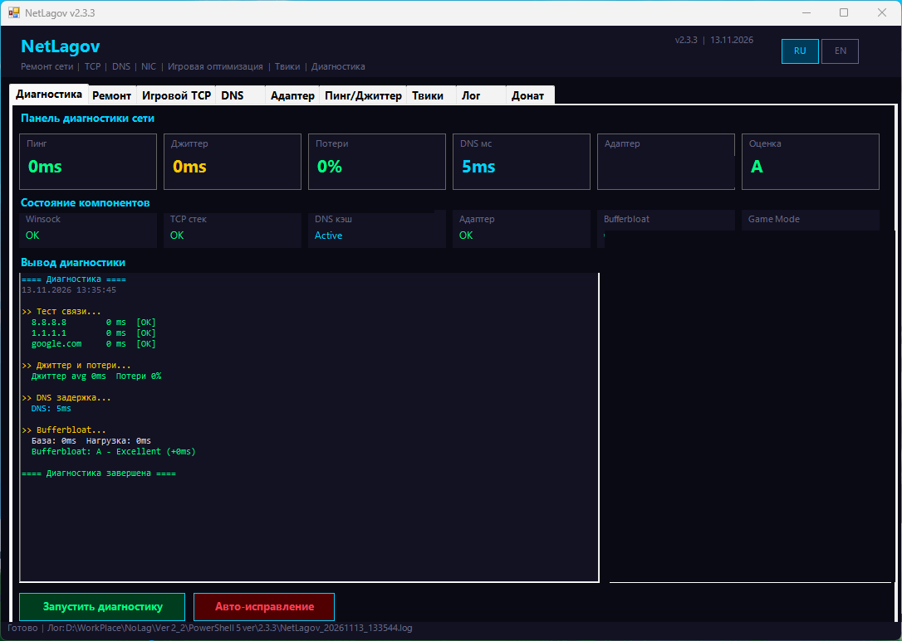
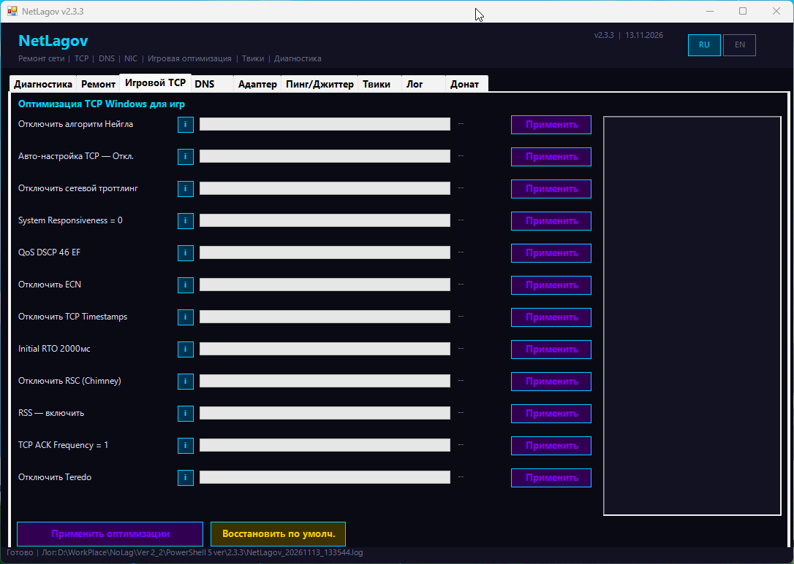
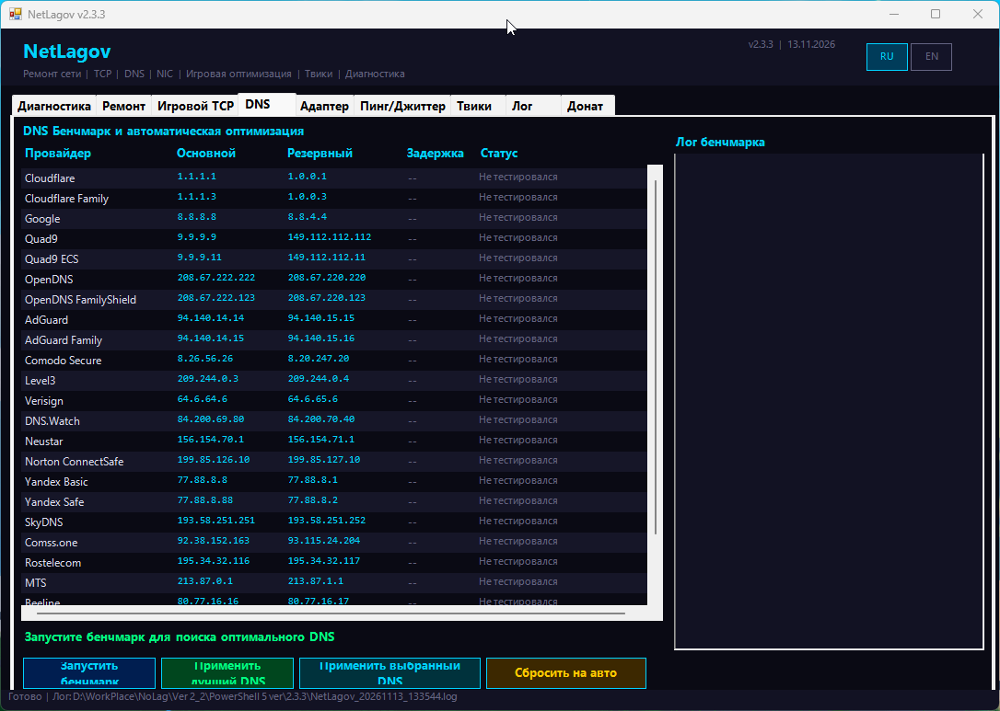
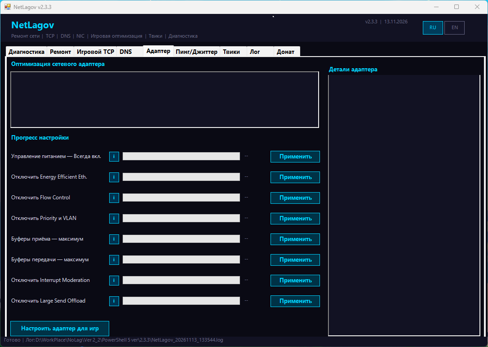
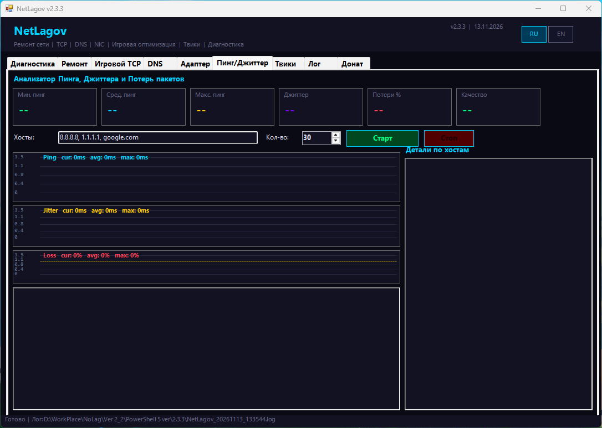
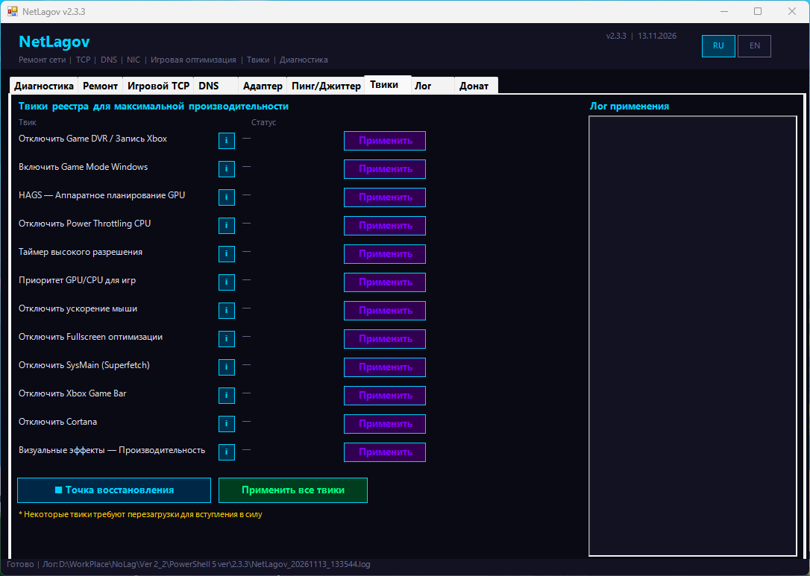
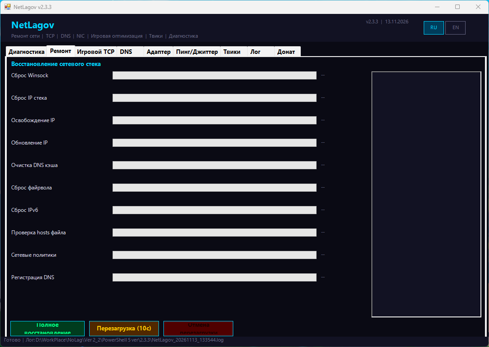

# NetLagov

[Русский](README.md) · [English](README.en.md)

NetLagov is a Windows desktop app that combines network diagnostics, network repair actions, and Windows and network adapter settings. It may be useful to everyday Windows users, gamers, and people troubleshooting connection problems. Results depend on hardware, drivers, the network, and the ISP; the app does not guarantee faster internet, lower ping, or a fix for every issue.

**Current version: 2.3.3 Final.**

## What it does

- **Network diagnostics:** active adapter details, connectivity checks to several hosts, ping, packet loss and jitter measurements, and DNS resolution time.
- **Network repair:** Winsock, TCP/IP, IPv6, and firewall resets; IP renewal; DNS cache clearing and registration; hosts file check; and other commands.
- **TCP and adapter settings:** applies selected Windows and driver settings individually or as a group. Availability and effects depend on the adapter, driver, and workload.
- **DNS:** compares ICMP response times to DNS server IP addresses, lets you select and apply a server to the active adapter, or return to automatic DNS.
- **Ping and jitter:** tests user-provided hosts, displays charts and statistics, and lets you set the request count.
- **Gaming and system settings:** includes Game Mode, Game DVR, HAGS, visual effects, power settings, and other Windows options. You can create a restore point before making changes.
- **Logs and support:** saves a log beside the app and provides a voluntary donation link.

The Bufferbloat indicator compares repeated ping measurements but does not create traffic load on the connection. Treat it as a basic indicator, not a full bufferbloat test. The DNS benchmark measures ICMP response time to each server IP, not the time taken to perform DNS queries.

## Project story

NetLagov began as a small PowerShell script for quickly resetting Windows network settings. It was meant to run the necessary commands in one place instead of having users search for instructions and enter commands by hand. Over time, it grew into a desktop app with a graphical interface, diagnostics, and more network and Windows settings.

## Built with AI

AI tools helped write and improve code, find errors, and add features. A person set the project direction, defined tasks, checked results, and made the decisions. The program was run and checked on a real system; this does not mean every Windows and hardware configuration has been tested.

## Screenshots

These images show version 2.3.3. Diagnostic values depend on the network and are not performance guarantees.

## Install and run

> **First launch:** wait for NetLagov to finish its startup diagnostics before applying settings. It checks access to external hosts and DNS; the time required depends on your network.

1. The current version is **2.3.3 Final**, file **NetLagov_PS5_v2_3_3_final.exe**. Download [NetLagov_PS5_v2_3_3_final.exe](https://github.com/KIBOON-afk/NetLagov/releases/download/v2.3.3/NetLagov_PS5_v2_3_3_final.exe).
2. Open the EXE and approve the Windows administrator prompt. Administrator rights are required to change system network settings.
3. After diagnostics finish, choose the tab and action you need.

The target operating systems are **Windows 10 and Windows 11**. NetLagov is developed for **Windows PowerShell 5.1**; PowerShell 7 is not a supported NetLagov environment. [Windows PowerShell 5.1 is included with Windows 10 and later](https://learn.microsoft.com/en-us/powershell/module/microsoft.powershell.core/about/about_windows_powershell_5.1); [PowerShell 7 is installed separately and does not replace it](https://learn.microsoft.com/en-us/powershell/scripting/install/install-powershell-on-windows).

The EXE is packaged from PowerShell code using [PS2EXE](https://github.com/MScholtes/PS2EXE). It opens like a regular app, but runs the packaged PowerShell code and uses Windows system components. You do not need to open the script manually to run the EXE.

## Important

NetLagov changes Windows network settings, adapter properties, and selected system options. Some actions can briefly interrupt connectivity, reset custom firewall rules, or affect individual apps. A performance improvement is not guaranteed. Read the action description before applying it. You can create a restore point before applying a group of settings. Record your original DNS and adapter values so you can restore them manually if needed.

## Version and updates

This page describes **2.3.3 Final**, the current working version and the starting point for the project history here. There is no verified changelog for earlier releases yet. Future entries should include only confirmed changes and dates.

## License

The 2.3.3 package does not include a license file, and project reuse and redistribution terms have not been stated. No open-source license has been selected for the project.

## Files

### For users

- **NetLagov_PS5_v2_3_3_final.exe** — the ready-to-run app and the recommended way to use NetLagov; the EXE requests administrator rights.
- **NetLagov_*.log** — a log created beside the app. It is not needed to run the program. Logs may contain the Windows account name and computer name; review them before publishing or sharing.

### For developers and building

- **NetLagov_v2_3_3_PS5.ps1** — the PowerShell source code.
- **NetLagov_v2_3_3_PS5_compile.ps1** — the source filename expected by the build script; its contents match the main source file.
- **Make_EXE_PS5.ps1** — the EXE build script. It installs the ps2exe module from PowerShell Gallery if needed.
- **NetLagov.ico** — the icon used to build the EXE.
- **README.md** and **README.en.md** — the Russian and English project pages.
- **images/** — page screenshots; they are not needed to run the app.

The EXE is built with [PS2EXE](https://github.com/MScholtes/PS2EXE).

## Voluntary support

If NetLagov is useful to you, you can support continued development through [DonationAlerts](https://www.donationalerts.com/r/kiboon). Donations are voluntary.

