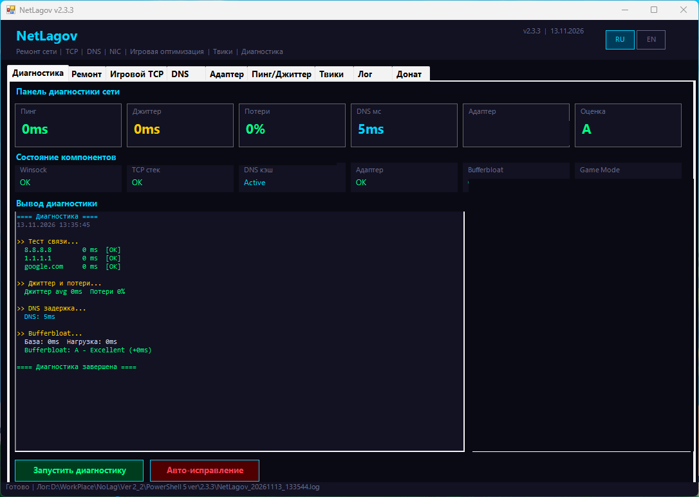
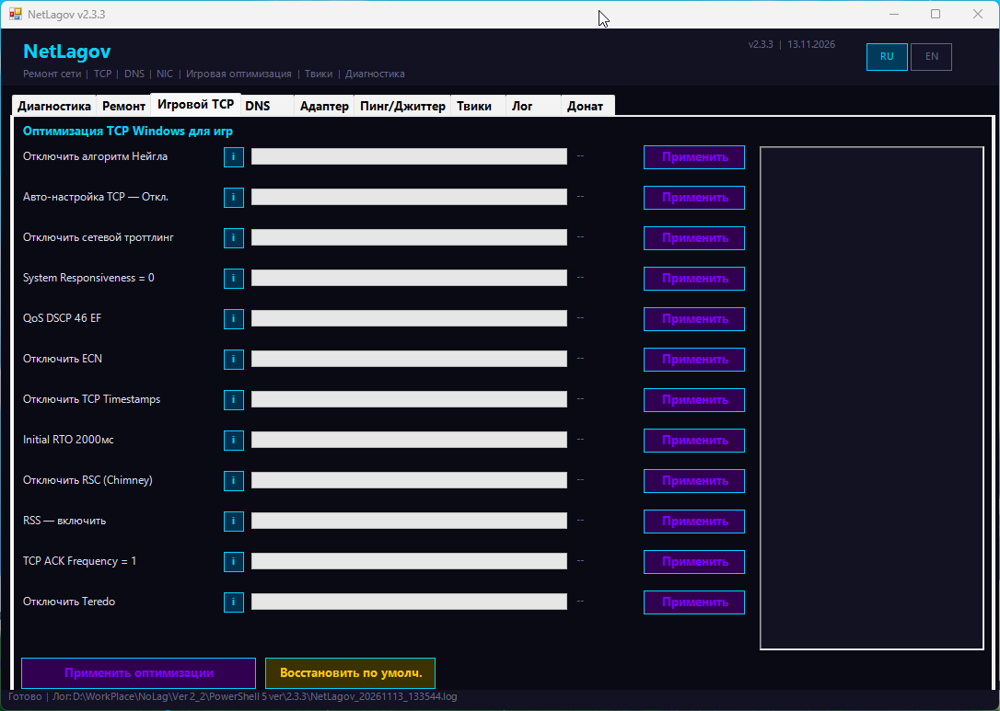
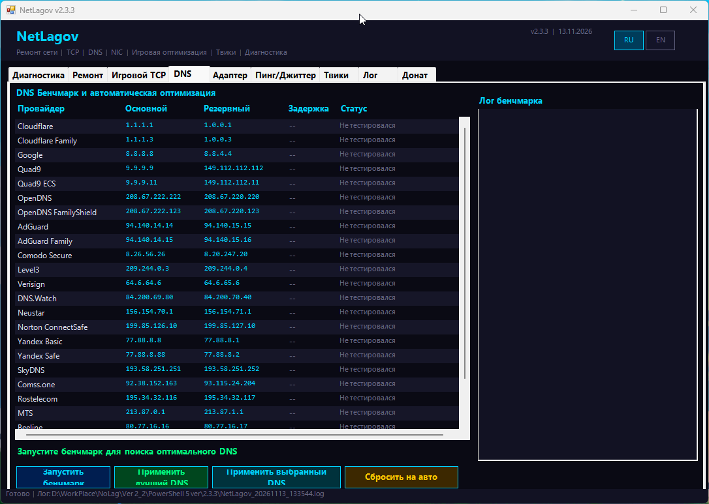
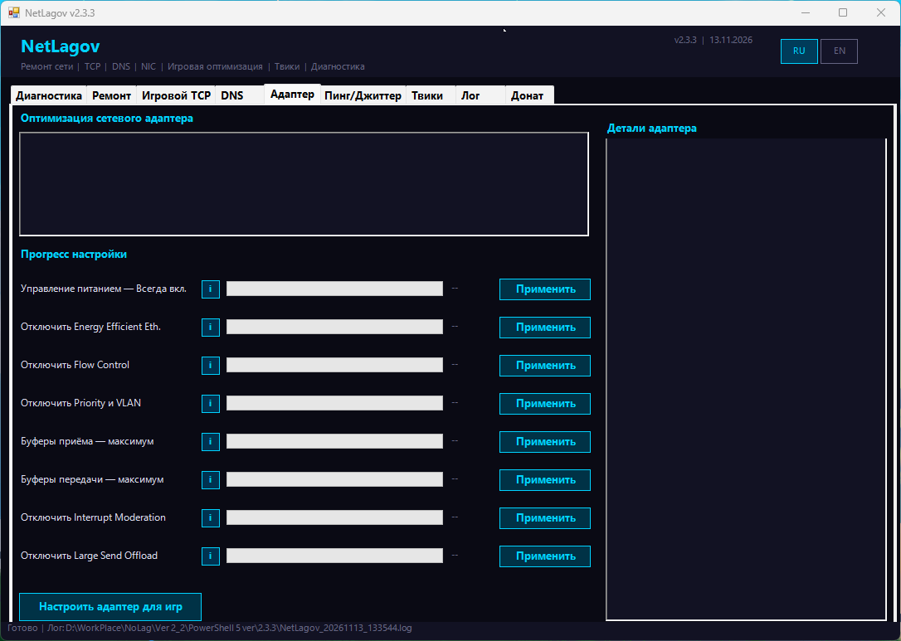
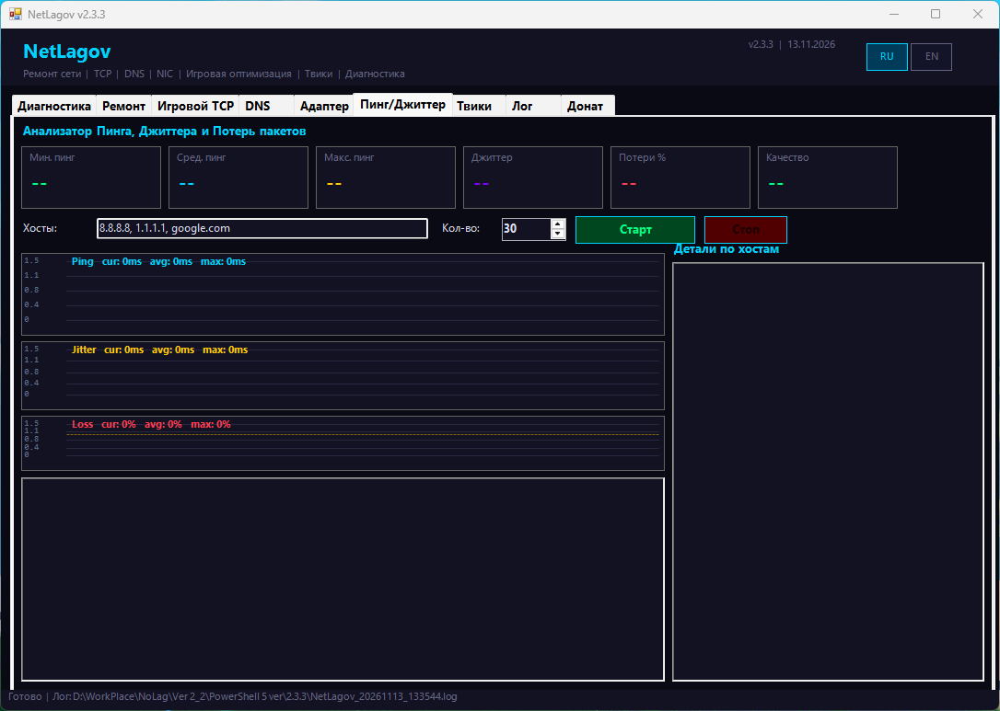
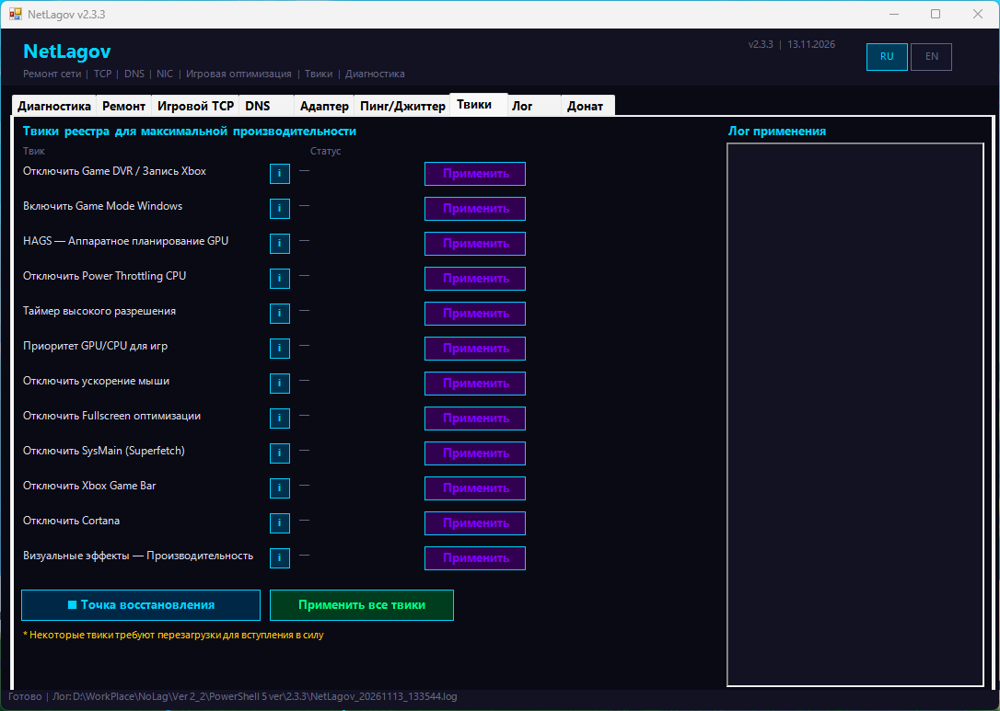
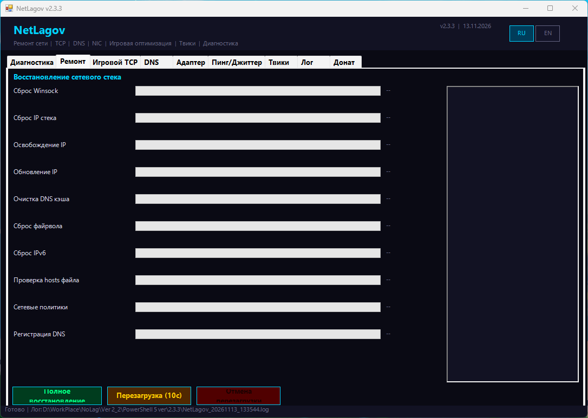

# NetLagov

[Русский](README.md) · [English](README.en.md)

NetLagov — настольная программа для Windows, объединяющая сетевую диагностику, восстановление сетевых компонентов и настройки Windows и сетевого адаптера. Она может пригодиться обычным пользователям, геймерам и тем, кто разбирается с проблемами подключения. Результат зависит от оборудования, драйверов, сети и провайдера: программа не гарантирует ускорение интернета, снижение пинга или исправление любой неполадки.

**Текущая версия: 2.3.3 Final.**

## Возможности

- **Диагностика сети:** сведения об активном адаптере, проверка связи с несколькими адресами, замеры пинга, потерь и джиттера, время DNS-разрешения.
- **Восстановление сети:** сброс Winsock, TCP/IP, IPv6 и брандмауэра, обновление IP, очистка и регистрация DNS, проверка файла hosts и другие команды.
- **TCP и адаптер:** применение отдельных системных параметров и настроек драйвера по одному или группой. Доступность и эффект зависят от адаптера, драйвера и нагрузки.
- **DNS:** сравнение отклика до IP-адресов DNS-серверов, выбор сервера, его применение к активному адаптеру и возврат к автоматическому DNS.
- **Пинг и джиттер:** проверка заданных адресов с графиками и статистикой; число запросов настраивается.
- **Игровые и системные параметры:** Game Mode, Game DVR, HAGS, визуальные эффекты, энергосбережение и другие настройки Windows. Перед изменениями можно создать точку восстановления.
- **Журнал и поддержка:** журнал рядом с программой и ссылка на добровольный донат.

Индикатор Bufferbloat в программе сравнивает повторные замеры пинга, но не создаёт нагрузку на канал. Это простой ориентир, а не полноценный тест bufferbloat. DNS-бенчмарк измеряет ICMP-отклик до IP-адреса сервера, а не скорость DNS-запросов.

## История проекта

NetLagov начинался как небольшой PowerShell-скрипт для быстрого сброса сетевых настроек Windows. Он должен был выполнять нужные команды в одном месте вместо поиска инструкций и ручного ввода. Со временем скрипт стал программой с графическим интерфейсом, диагностикой и дополнительными настройками сети и Windows.

## Разработка с помощью ИИ

Нейросети помогали писать и улучшать код, искать ошибки и добавлять возможности. Человек задавал направление проекта, ставил задачи, проверял результаты и принимал решения. Программу запускали и проверяли на реальной системе; это не означает, что проверены все конфигурации Windows и оборудования.

## Скриншоты

Это снимки интерфейса версии 2.3.3. Значения диагностики зависят от сети и не являются обещанием результата.

## Установка и запуск

> **Первый запуск:** дождитесь окончания стартовой диагностики NetLagov и только после этого начинайте применять настройки. Программа проверяет доступность внешних адресов и DNS; время проверки зависит от сети.

1. Текущая версия — **2.3.3 Final**, файл **NetLagov_PS5_v2_3_3_final.exe**. [Скачать NetLagov_PS5_v2_3_3_final.exe](https://github.com/KIBOON-afk/NetLagov/raw/refs/heads/main/NetLagov_PS5_v2_3_3_final.exe).
2. Откройте EXE и подтвердите запрос Windows на права администратора. Они необходимы для изменения системных сетевых настроек.
3. После диагностики выберите нужную вкладку и действие.

Целевые системы — **Windows 10 и Windows 11**. Программа разрабатывается для **Windows PowerShell 5.1**; PowerShell 7 не является поддерживаемой средой NetLagov. [Windows PowerShell 5.1 входит в Windows 10 и более поздние версии](https://learn.microsoft.com/en-us/powershell/module/microsoft.powershell.core/about/about_windows_powershell_5.1); [PowerShell 7 устанавливается отдельно и не заменяет его](https://learn.microsoft.com/en-us/powershell/scripting/install/install-powershell-on-windows).

EXE собран из PowerShell-кода инструментом [PS2EXE](https://github.com/MScholtes/PS2EXE). Его запускают как обычную программу, но внутри он выполняет упакованный PowerShell-код и использует системные средства Windows. Открывать скрипт вручную для запуска EXE не нужно.

## Важное предупреждение

NetLagov меняет сетевые параметры Windows, свойства адаптера и отдельные системные настройки. Некоторые действия могут временно прервать подключение, сбросить пользовательские правила брандмауэра или повлиять на отдельные приложения. Улучшение производительности не гарантируется. Перед изменениями прочитайте описание действия; перед групповой настройкой можно создать точку восстановления. Запишите исходные значения DNS и адаптера, чтобы при необходимости вернуть их вручную.

## Версия и обновления

Страница описывает **2.3.3 Final** — текущую рабочую версию и начальную точку истории проекта здесь. Проверенной истории предыдущих выпусков пока нет. Для будущих версий следует добавлять только подтверждённые изменения и даты.

## Лицензия

В комплекте версии 2.3.3 нет файла лицензии, а условия повторного использования и распространения не указаны. Открытая лицензия для проекта не выбрана.

## Файлы

### Для обычного пользователя

- **NetLagov_PS5_v2_3_3_final.exe** — готовая программа и рекомендуемый способ запуска; EXE запросит права администратора.
- **NetLagov_*.log** — журнал, создаваемый рядом с программой. Для запуска он не нужен. В журнал могут попадать имя учётной записи Windows и имя компьютера; проверьте файл перед публикацией или отправкой.

### Для разработчика и сборки

- **NetLagov_v2_3_3_PS5.ps1** — исходный PowerShell-код.
- **NetLagov_v2_3_3_PS5_compile.ps1** — имя исходника, ожидаемое сценарием сборки; его содержимое совпадает с основным исходником.
- **Make_EXE_PS5.ps1** — сценарий сборки. При необходимости устанавливает модуль ps2exe из PowerShell Gallery.
- **NetLagov.ico** — значок, используемый при сборке EXE.
- **README.md** и **README.en.md** — страницы проекта на русском и английском языках.
- **images/** — скриншоты для страницы; программе они не нужны.

Для сборки используется [PS2EXE](https://github.com/MScholtes/PS2EXE).

## Добровольная поддержка

Если NetLagov вам полезен, вы можете поддержать дальнейшую разработку через [DonationAlerts](https://www.donationalerts.com/r/kiboon). Донат добровольный.

